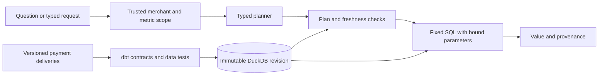

# Architecture

## Data and business rules

- Captures, refunds and attempts use composite keys with the merchant ID. Highest version wins. Equivalent deliveries collapse and conflicting versions fail the dbt build. The marts retain the accepted version.
- A refund inherits currency and provider from the capture in its merchant. The net calculation aggregates settled captures and refunds independently and subtracts the refund total. Each movement uses its own settlement date.
- Attempt completion dates determine the rate. Only successful and failed terminal attempts contribute to its denominator. Empty periods return a null rate with counts of zero.
- Paying orders counts distinct order IDs inside the requested scope. Summing daily distinct counts can count an order twice.
- Business dates use Africa/Johannesburg. The interval includes its start and excludes its end. This fixture has ZAR and USD with two decimal places each. Answers name the selected currency and display a trusted profile default if one was used.

## Authority and execution

The launcher supplies a simulated principal with server-owned entitlements. The merchant requested by the caller is checked before catalog discovery and planning. The service checks metric, date and provider scope again before compiling SQL. A natural-language planner cannot silently supply a missing currency or make its own CARD selection for an operations reader.

The compiler chooses SQL from fixed templates and binds the tenant, dates, currency and provider independently on each fact scan. The DuckDB subprocess opens only the pinned snapshot in read-only mode, disables external access and extension autoloading, uses two threads and caps memory at 256 MiB. The supervisor enforces a three-second deadline and withholds partial results. The isolated Compose reader runs under a separate OS identity with a read-only mount and no network.

The builder runs dbt in a temporary candidate directory. It publishes immutable files by revision after seven checks pass. An atomic pointer update makes the complete set visible. Each request resolves the pointer once and uses that revision for metadata and facts. A failed build preserves the existing pointer.

## Deployment mapping and next work

- In a deployed service, authenticate in middleware and map verified subject and issuer to server-owned entitlements before calling the same policy checks.
- Run the read process with a read-only mount containing published snapshots. Give the builder separate storage permissions. Forward redacted service traces to an audit destination with its own access policy.
- Give additional input validations and data volume tests priority before serving live production data. The current warehouse, identities, loaded times and facts are synthetic.
- Measure the optional provider on a fresh challenge split before expanding what it can infer. Include repeated trials and review the cost, clarifications and evidence for each arm.
